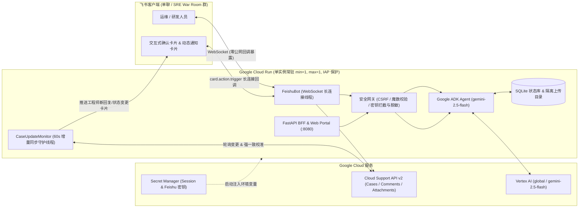

# Google Cloud Support 智能工单系统 — 部署与运维配置指南

本文档面向系统管理员、DevOps 与云平台运维工程师，详细说明 **Cloud Case Management Agent (`cloud-case-agent`)** 从零配置 GCP 权限、飞书开放平台应用、本地调试到 Cloud Run 生产部署、演练/正式模式切换及日常排错的完整流程。

---

## 1. 系统架构总览



### 关键架构约束说明（必读）
1. **单实例常驻（`--min-instances 1 --max-instances 1 --no-cpu-throttling`）**：
   - 飞书机器人采用官方 SDK **WebSocket 长连接模式**（无需暴露公网 Webhook URL，支持全开启 `--no-allow-unauthenticated` 与 `--iap`）。
   - 必须开启 `--no-cpu-throttling`（CPU 始终分配）与 `min-instances=1`，否则 Cloud Run 在无 HTTP 请求时会冻结 CPU，导致飞书 WebSocket 断连及后台 `CaseUpdateMonitor` 轮询线程暂停。
   - 必须限制 `max-instances=1`，避免多实例竞争同一飞书 App 的长连接事件以及保证容器内 SQLite 草稿/订阅状态与暂存附件目录强一致。
2. **Vertex AI 模型区域（`GOOGLE_CLOUD_LOCATION=global`）**：
   - 系统默认使用最新 GA 的 **`gemini-2.5-flash`**（主智能体与飞书群聊相关性路由分类器共用），Vertex AI 端点区域需固定配置为 `global`。

---

## 2. 部署前置条件

1. **Google Cloud Support 支持计划权限**：
   - 目标 GCP 组织/项目已开通 **Role-Based / Standard / Enhanced / Premium Support**（免费 Basic Support 不允许通过 API 创建技术支持工单）。
2. **本地部署机器环境**：
   - 已安装 [Google Cloud SDK (`gcloud`)](https://cloud.google.com/sdk/docs/install)
   - 本地开发测试需安装 Python `3.11` 或 `3.12` 及 [`uv`](https://docs.astral.sh/uv/)（生产部署通过 Cloud Build 使用项目自带 `Dockerfile` 构建 Python 3.12 镜像）。
3. **部署操作人权限**：
   - 执行部署脚本的账号需具备目标部署项目的 Cloud Run Admin、Cloud Build Editor、Service Account User、Secret Manager Viewer 权限。

---

## 3. GCP 项目初始化（首次部署执行一次）

以下假设部署宿主项目为 `PROJECT_ID="demo-core-prod"`，部署区域为 `REGION="us-central1"`。

### 3.1 启用所需 Google Cloud API

```bash
export PROJECT_ID="demo-core-prod"
export REGION="us-central1"

gcloud services enable \
  run.googleapis.com \
  cloudbuild.googleapis.com \
  artifactregistry.googleapis.com \
  secretmanager.googleapis.com \
  aiplatform.googleapis.com \
  cloudsupport.googleapis.com \
  iap.googleapis.com \
  logging.googleapis.com \
  cloudtrace.googleapis.com \
  --project="${PROJECT_ID}"
```

### 3.2 创建 Cloud Run 运行时服务账号并授予最小权限

```bash
export RUNTIME_SA_NAME="cloud-case-agent-run"
export RUNTIME_SA="${RUNTIME_SA_NAME}@${PROJECT_ID}.iam.gserviceaccount.com"

# 1. 创建运行时专用 Service Account
gcloud iam service-accounts create "${RUNTIME_SA_NAME}" \
  --display-name="Cloud Case Agent Runtime SA" \
  --project="${PROJECT_ID}"

# 2. 授予 Vertex AI 调用、Cloud Support 工单读写、日志与链路追踪权限
for ROLE in \
  roles/aiplatform.user \
  roles/cloudsupport.techSupportEditor \
  roles/logging.logWriter \
  roles/cloudtrace.agent; do
  gcloud projects add-iam-policy-binding "${PROJECT_ID}" \
    --member="serviceAccount:${RUNTIME_SA}" \
    --role="${ROLE}"
done
```

> **多项目纳管（跨项目提单/查单）授权说明**：  
> 如果您希望机器人同时管理多个客户/业务 GCP 项目（例如 `ALLOWED_PROJECTS="proj-prod-01,proj-data-02"`），只需在每个被纳管项目（或外层 Folder / Organization 级）为上述同一个 `${RUNTIME_SA}` 授予 `roles/cloudsupport.techSupportEditor` 即可：
> ```bash
> gcloud projects add-iam-policy-binding "proj-data-02" \
>   --member="serviceAccount:${RUNTIME_SA}" \
>   --role="roles/cloudsupport.techSupportEditor"
> ```

### 3.3 在 Secret Manager 中托管敏感密钥

切勿将密钥硬编码进代码库或 `Dockerfile`。在 Secret Manager 中创建以下 3 个密钥并授权给 `${RUNTIME_SA}`：

```bash
# 1. 生成 32 字节以上高强度 Web Session / CSRF 签名密钥
python3 -c "import secrets; print(secrets.token_hex(32), end='')" | \
  gcloud secrets create SESSION_SECRET_KEY --data-file=- --project="${PROJECT_ID}"

# 2. 存入飞书自建应用的 App ID 与 App Secret（获取方式见第 4 节）
printf "%s" "cli_xxxxxxxxxxxxxxxx" | \
  gcloud secrets create FEISHU_APP_ID --data-file=- --project="${PROJECT_ID}"

printf "%s" "your_feishu_app_secret" | \
  gcloud secrets create FEISHU_APP_SECRET --data-file=- --project="${PROJECT_ID}"

# 3. 授权运行时 SA 读取上述 Secret
for SECRET_NAME in SESSION_SECRET_KEY FEISHU_APP_ID FEISHU_APP_SECRET; do
  gcloud secrets add-iam-policy-binding "${SECRET_NAME}" \
    --member="serviceAccount:${RUNTIME_SA}" \
    --role="roles/secretmanager.secretAccessor" \
    --project="${PROJECT_ID}"
done
```

---

## 4. 飞书开放平台应用配置指南

登录 [飞书开放平台后台](https://open.feishu.cn/app) 创建「企业自建应用」，按顺序完成以下 4 步：

### 4.1 启用机器人能力
- 进入「添加应用能力」→ 添加 **「机器人 (Bot)」**。
- 在「凭证与基础信息」页面记录 **App ID (`cli_...`)** 和 **App Secret**，填入上一节的 Secret Manager。

### 4.2 开通 API 权限（权限管理）
在「开发配置 → 权限管理」中搜索并开通以下权限：

| 权限标识 (Scope) | 权限名称 | 用途说明 | 是否必选 |
|---|---|---|---|
| `im:message` | 获取与发送单聊、群组消息 | 发送工单草稿确认卡片、Markdown 回复与动态更新通知 | **必选** |
| `im:message.p2p_msg:readonly` (或 `im:message.p2p_msg`) | 读取用户发给机器人的单聊消息 | 支持私聊机器人提单、查单与传图 | **必选** |
| `im:message.group_at_msg:readonly` (或 `im:message.group_at_msg`) | 获取群组中 `@机器人` 的消息 | 群聊 `@机器人` 唤醒报障与卡片协同 | **必选** |
| `im:message.group_msg` | 获取群组中所有消息 | 支持群聊被 `@` 后 10 分钟内免 `@` 追问跟进、群成员补充上下文及引用卡片直接回复 | 强烈推荐 |
| `im:resource` | **获取与上传图片或文件资源** | **核心权限**：下载用户在飞书中直接发送的报错截图、`post` 粘贴图片及 `.yaml`/`.log`/`.zip` 诊断文件 | **必选** |
| `im:chat:readonly` | 获取群组信息 | 当外部（如 GCP Console）新建工单且尚无会话订阅时，自动发现机器人所在活跃运维群推送动态 | 推荐 |

### 4.3 配置长连接事件与卡片回调（无需公网 URL）
> **重要提示**：配置飞书后台「长连接」保存时，飞书服务器会实时检测当前是否已有客户端连上长连接。请**先完成第 6 节首次 Cloud Run 部署**使线上容器连入飞书后，再点击保存长连接订阅。

1. **事件配置（「事件与回调 → 事件配置」）**：
   - 订阅方式选择：**「使用长连接接收事件 (Receive events through persistent connection)」**
   - 添加事件：**`im.message.receive_v1`（接收消息 v2.0）**
2. **回调配置（「事件与回调 → 回调配置」）**：
   - 订阅方式选择：**「使用长连接接收回调」**
   - 添加回调：**`card.action.trigger`（卡片回传交互）**

### 4.4 发布版本并拉入群聊
- 进入「版本管理与发布」→ 创建新版本并提交发布（每次新增权限如 `im:resource` 后，均需重新发布一个版本方能生效）。
- 发布通过后，在飞书客户端打开目标运维群 →「群设置 → 群机器人 → 添加机器人」搜索应用名称加入即可。

---

## 5. 本地开发、测试与仿真演练

> ⚠️ **严禁抢占线上飞书连接警告**：  
> 飞书长连接同一时刻会将事件分发给连接池中的实例。线上 Cloud Run 正在运行时，**切勿在本地 `.env` 中配置真实的生产 `FEISHU_APP_ID` 和 `FEISHU_APP_SECRET` 启动服务**，否则本地进程会分走线上群聊消息！本地调试飞书逻辑请使用内置的全链路仿真脚本。

```bash
# 1. 安装依赖（使用项目虚拟环境）
uv sync

# 2. 运行全量单元、安全与运维场景测试（80 项用例，默认隔离在 MOCK 模式运行）
.venv/bin/pytest -v

# 3. 运行代码静态检查
.venv/bin/ruff check --select F,E9 app/ tests/

# 4. 运行真实 Gemini 4 Hydrogen 大模型 + 飞书全场景端到端仿真（不连接真实飞书、不建真实工单）
GOOGLE_CLOUD_PROJECT=demo-core-prod GOOGLE_CLOUD_LOCATION=global GOOGLE_GENAI_USE_VERTEXAI=true \
  .venv/bin/python -u tests/sim/feishu_simulation.py

# 5. 本地启动 Web 门户（MOCK 演练模式）
SUPPORT_API_MODE=MOCK CHAT_ENGINE=llm GOOGLE_CLOUD_PROJECT=demo-core-prod GOOGLE_CLOUD_LOCATION=global \
  .venv/bin/uvicorn app.fast_api_app:app --reload --port 8080
```

---

## 6. Cloud Run 生产部署与运行模式切换

项目提供标准化一键部署脚本 [`deployment/deploy_prod.sh`](../deployment/deploy_prod.sh)，默认开启 `--no-allow-unauthenticated` 与 `--iap` 保护 Web 端，并自动检测挂载 Secret Manager 中的飞书凭证。

### 6.1 模式一：安全演练模式部署（推荐首次上线与日常联调）
在此模式下，`SUPPORT_API_MODE=LIVE` 且 **`FORCE_TEST_CASE=true`**：
- 真实调用 Google Cloud Support API v2 完成分类检索、建单、评论、改优先级、上传下载附件及飞书通知推送；
- 所有新建工单强制注入官方内部测试标记 `Case.test_case = True`（Protobuf 字段 19），**Google Support 后台绝不会分配真人工程师接单**，可放心在飞书全流程实测。

```bash
FORCE_TEST_CASE=true \
CASE_POLL_INTERVAL_SECONDS=60 \
CASE_AGENT_MODEL=gemini-2.5-flash \
PROJECT=demo-core-prod \
REGION=us-central1 \
bash deployment/deploy_prod.sh
```

### 6.2 模式二：切换为正式生产提单模式（真人 Google 工程师接单）
演练验收无误、准备正式投入生产报障时，将 `FORCE_TEST_CASE` 设为 `false` 重新执行部署：

```bash
FORCE_TEST_CASE=false \
CASE_POLL_INTERVAL_SECONDS=60 \
CASE_AGENT_MODEL=gemini-2.5-flash \
PROJECT=demo-core-prod \
REGION=us-central1 \
bash deployment/deploy_prod.sh
```

> **提示**：如果需要纳管多个 GCP 项目或配置飞书值班管理员（可代批任何人的确认卡片），可在部署命令或脚本 `--update-env-vars` 中通过特殊分隔符 `^:^` 传入逗号列表，例如：
> ```bash
> gcloud run services update cloud-case-agent \
>   --project=demo-core-prod --region=us-central1 \
>   --update-env-vars="^:^ALLOWED_PROJECTS=demo-core-prod,prod-core-01:FEISHU_ADMIN_OPEN_IDS=ou_sre_lead_01,ou_sre_lead_02"
> ```

---

## 7. 环境变量完整参考表

| 变量名 | 默认值 | 说明 |
|---|---|---|
| `SUPPORT_API_MODE` | `MOCK`（生产脚本设为 `LIVE`） | `MOCK` 仅读写本地模拟库；`LIVE` 双向同步 Google Cloud Support API v2。 |
| `FORCE_TEST_CASE` | `true` | `true` 时强制所有新建工单 `test_case=True`（不触发真人接单）；正式生产提单设为 `false`。 |
| `ALLOWED_PROJECTS` | `gcp-prod-core-01,...` | 允许 Agent 与 API 操作的 GCP Project ID 白名单（逗号分隔），越权请求会被强拦截。 |
| `CASE_AGENT_MODEL` | `gemini-2.5-flash` | ADK 主智能体及飞书群聊上下文分类器使用的 Gemini 模型名称。 |
| `CHAT_ENGINE` | `llm` | `llm` 使用 Gemini ADK 推理；`deterministic` 使用纯规则兜底编排器（离线测试用）。 |
| `GOOGLE_GENAI_USE_VERTEXAI` | `true` | 使用 Vertex AI 企业级端点鉴权（基于 Cloud Run 运行时 Service Account ADC）。 |
| `GOOGLE_CLOUD_PROJECT` | — | 调用 Vertex AI 模型计费与配额归属的 GCP Project ID。 |
| `GOOGLE_CLOUD_LOCATION` | `global` | Vertex AI 模型区域（`gemini-2.5-flash` / `gemini-3.8-flash` 须设为 `global`）。 |
| `SESSION_SECRET_KEY` | Secret Manager 注入 | 至少 32 字符，用于 HMAC-SHA256 签名 Web `__Host-session` Cookie 与 CSRF Token。 |
| `FEISHU_APP_ID` | Secret Manager 注入 | 飞书企业自建应用 App ID（未配置则自动跳过启动飞书线程）。 |
| `FEISHU_APP_SECRET` | Secret Manager 注入 | 飞书企业自建应用 App Secret。 |
| `FEISHU_DEFAULT_PROJECT` | `ALLOWED_PROJECTS` 第 1 项 | 飞书对话中用户未显式说出项目名时默认使用的 GCP Project ID。 |
| `FEISHU_ALLOWED_CHAT_IDS` | 空（不限制） | 可选：逗号分隔的飞书 `chat_id`（`oc_xxx`）白名单；设置后仅响应白名单群/会话。 |
| `FEISHU_ADMIN_OPEN_IDS` | 空 | 可选：逗号分隔的值班负责人/SRE Lead 飞书 `open_id`（`ou_xxx`），可直接代确认/取消群内草稿卡片。 |
| `FEISHU_FOLLOWUP_SECONDS` | `600` | 群聊 `@机器人` 后同一成员免 `@` 持续对话的时间窗口（秒）。 |
| `FEISHU_CONTEXT_SECONDS` | `1800` | 群聊机器人活跃期间利用上下文判断其他成员无 `@` 发言是否针对机器人的窗口（秒）。 |
| `CASE_POLL_INTERVAL_SECONDS` | `60` | 后台轮询 Google Support 工单状态、新评论、新附件并推送飞书通知卡片的间隔（秒，`<=0` 关闭）。 |
| `FEISHU_NOTIFY_CHAT_IDS` | 空 | 可选：兜底接收所有未绑定会话工单（如在 GCP Console 直接所提工单）更新通知的飞书群 `oc_xxx`。 |
| `FEISHU_AUTO_NOTIFY_BOT_CHATS` | `true` | 当无显式订阅且未配 `FEISHU_NOTIFY_CHAT_IDS` 时，自动查询机器人所在群推送外部新建工单动态。 |
| `FEISHU_WEBHOOK_URL` / `FEISHU_WEBHOOK_SECRET` | 空 | 可选：飞书自定义群机器人 Webhook 地址（严格校验 `open.feishu.cn` / `open.larksuite.com` 防 SSRF）与签名密钥。 |
| `DEFAULT_SUBSCRIBER_EMAILS` | 空 | 可选：新建工单默认附加的抄送邮箱列表（逗号分隔）。 |

---

## 8. 部署后验收与常见故障排查

### 8.1 查看 Cloud Run 实时启动与飞书连接日志

```bash
gcloud logging read \
  'resource.type="cloud_run_revision" AND resource.labels.service_name="cloud-case-agent"' \
  --project=demo-core-prod --limit=30 \
  --format="value(timestamp,severity,textPayload)"
```

看到以下两行日志即代表服务与飞书长连接 100% 正常就绪：
- `INFO app.feishu_bot: Feishu bot thread started.`
- `INFO app.feishu_bot: Feishu long connection established.`

### 8.2 常见问题速查表（Troubleshooting）

| 现象 / 报错信息 | 根因说明 | 解决方案 |
|---|---|---|
| 飞书中发送截图提示 **`缺少获取消息资源权限 (im:resource)`** | 飞书应用尚未开通资源读取权限，或开通后未重新发版 | 在飞书开放平台勾选 `im:resource` 权限 → 进入「版本管理与发布」创建新版本并发布生效。 |
| 卡片确认提交报错 **`[400] You are not eligible to create a case`** | 目标 GCP 项目未购买付费技术支持计划，或运行时 SA 缺少 `techSupportEditor` | 确认项目已绑定 Standard/Enhanced/Premium Support，并为运行时 SA 授予 `roles/cloudsupport.techSupportEditor`。 |
| 模型调用报错 **`404 Publisher model ... not found`** | `GOOGLE_CLOUD_LOCATION` 被设为了区域级（如 `us-central1`） | 确保环境变量 `GOOGLE_CLOUD_LOCATION=global`。 |
| 群里 `@机器人` 无反应，或偶发一半消息没响应 | 本地开发机或其他环境同时跑着相同 `FEISHU_APP_ID` 的进程分走了 WebSocket 事件 | 停止本地挂载真实飞书密钥的进程，确保只有线上单实例 Cloud Run 连接该飞书应用。 |
| 卡片点击确认提示 **`只有发起人或已授权的值班同事可以确认此工单`** | 安全防误触机制阻止无关群成员代点他人草稿 | 由原发起人在群内发送 `@机器人 把草稿转交给 @接班同事 代确认`，或将值班主管 `open_id` 配入 `FEISHU_ADMIN_OPEN_IDS`。 |
